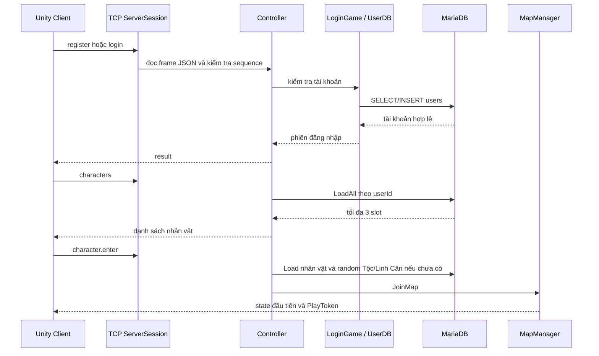
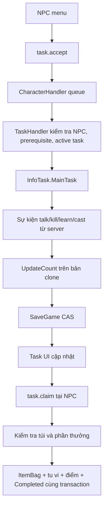
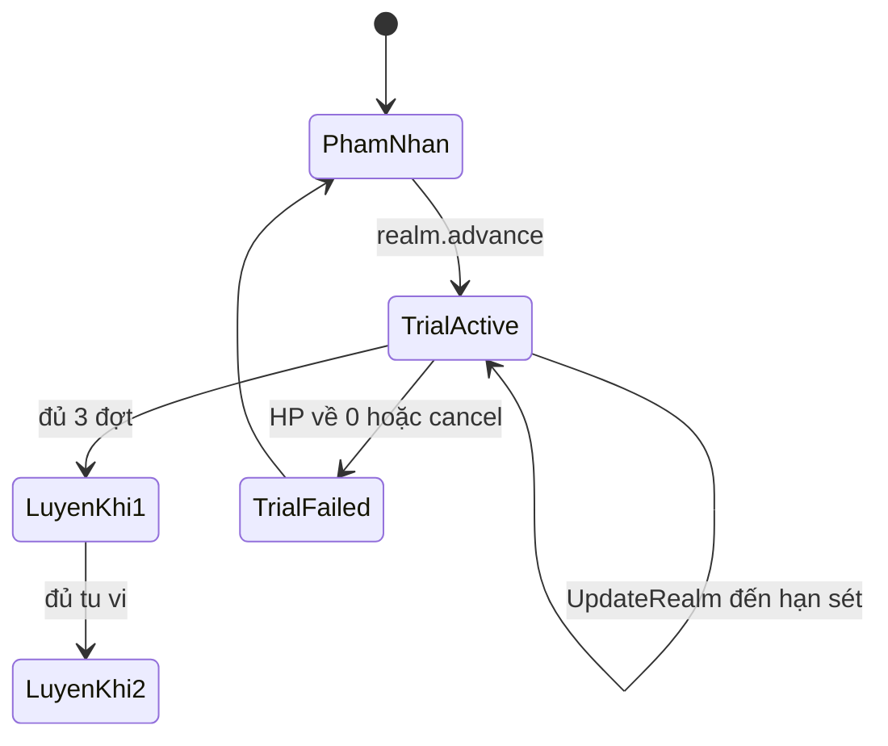

# Tu Tiên

## Trạng thái dự án

Tu Tiên là bản nền server và Unity client cho MMORPG top-down nhiều người chơi. Bản hiện tại được phát triển theo ba tuần công việc để ưu tiên một vòng chơi có thể chạy được từ đăng nhập đến tiến cấp.

| Tuần | Phần hoàn thành |
|---|---|
| 1 | Cấu trúc server, MariaDB, login, 3 slot nhân vật, TCP, catalog và CDN |
| 2 | Map/zone, NPC, movement, quái, PvE/PvP, inventory, trang bị và đan dược |
| 3 | Nhiệm vụ, kỹ năng, tu vi, cảnh giới, Lôi Kiếp và UI Unity |

Các thông số hiện tại là thông số demo để tiếp tục cân bằng.

## Vòng chơi hiện tại

```text
Login → Chọn nhân vật → Thiên Phú → Vào map
      → NPC → Nhiệm vụ → Combat → Nhận thưởng
      → Học skill → Dùng skill → Tiến cấp → Lôi Kiếp
```

## Luồng login và vào game



Mỗi request TCP có `sequence`. Các lệnh mutation dùng `PlayToken` và `GameRevision`. Khi phiên khác chiếm quyền nhân vật, phiên cũ bị rời map và không được phép ghi đè dữ liệu mới.

## Luồng tạo nhân vật

1. Client gửi slot, đạo hiệu, classId, giới tính và appearanceId.
2. Controller kiểm tra dữ liệu và quyền sở hữu slot.
3. Server lấy class/appearance hợp lệ từ catalog, không tin race/element do client gửi.
4. CharacterDB tạo `InfoChar`, `InfoGame`, `ItemBody`, `ItemBag`, `ItemBox`.
5. Khi nhân vật vào game lần đầu, server random Tộc và Linh Căn rồi lưu trước khi trả kết quả.
6. Unity hiển thị bảng Thiên Phú và chỉ cho vào WorldScene sau khi xác nhận.

## Luồng map và zone

```text
TCP move
  → Controller
  → MapManager.SetPosition
  → queue của map worker
  → kiểm tra tốc độ, collision, zone và tọa độ
  → cập nhật Position
  → snapshot world 5 lần/giây
```

Map worker là owner của nhân vật trong map đó. Network thread không sửa trực tiếp collection của zone. Chuyển map dừng snapshot cũ, lưu vị trí, reserve zone đích, đổi PlayToken rồi mới đăng ký nhân vật vào zone mới.

NPC được đọc từ `map_template.arrNpc`; thông tin tên, avatar và chat lấy từ `npc_template`. Không có bảng NPC riêng cho từng map.

## Luồng nhiệm vụ



Một nhân vật chỉ có một `MainTask`. Tiến độ không nhận từ client. `TaskHandler` chỉ đánh dấu hoàn thành sau khi thao tác gốc đã thành công. Nếu nhiều item thưởng không vừa túi, toàn bộ phần thưởng bị từ chối và nhiệm vụ vẫn còn active.

## Luồng nhận thưởng nhiều item

`task_template.reward` là JSON array được deserialize thành `List<GameItem>`:

```json
[
  {"id":3010,"quantity":2,"options":[]},
  {"id":3020,"quantity":1,"options":[]}
]
```

Khi claim:

1. Clone nhân vật.
2. Kiểm tra toàn bộ item, option, stack và số ô trống trên clone.
3. Tạo UID/IndexUI mới cho từng item.
4. Chỉ khi tất cả item hợp lệ mới cộng tu vi/điểm và thêm `Completed`.
5. `CharacterDB.SaveGame` dùng `game_revision` để commit.
6. Commit thành công mới publish dữ liệu vào nhân vật đang chạy.

## Luồng combat

```text
skill.use hoặc monster.attack
  → kiểm tra token, HP, target, LifeId, zone, range, cooldown
  → clone attacker/victim
  → kiểm tra MP và skill cooldown
  → roll dodge
  → damage = max(0, attack - defence)
  → critical thì damage × 2
  → SaveCombat hoặc SaveMonsterKill
  → publish HP, attack event, loot sau commit
```

Combat không xử lý trong `MapManager`. `SkillHandler` giữ công thức đánh, `MonsterMapHandler` giữ AI, `CharacterHandler` giữ queue và lưu nhân vật.

Kết liễu quái ghi receipt `monster_kill`, tu vi và item rơi trong cùng transaction. Nếu client gửi lại LifeId cũ, receipt ngăn nhận thưởng lần hai.

## Luồng kỹ năng

```text
NPC truyền công
  → skill.learn
  → kiểm tra class, realm, tu vi, teacher NPC
  → trừ tu vi trên clone
  → thêm hoặc nâng SkillCharacter
  → tự gán slot trống đầu tiên
  → SaveGame CAS
```

- Mỗi class hiện có một active skill chạy thật.
- Skill có MP, tầm đánh, cooldown và hệ số damage theo cấp.
- Phàm Nhân có 1 slot; Luyện Khí mở 3 slot.
- `skill.assign` di chuyển skill giữa các slot, không nhân bản.
- `LastTimeUse`, level và slot được lưu trong database.

## Luồng tu vi và Lôi Kiếp



`InfoBreakthrough` lưu target realm, tu vi đã dành, số đợt, thời điểm đợt tiếp theo, phần trăm damage và kết quả. Map worker gọi `UpdateRealm` theo thời gian UTC. Khi login lại, các đợt quá hạn được xử lý từ dữ liệu đã lưu, không tạo lại từ đầu.

## Kiến trúc server

```text
Unity Client
    │ 4 byte length + JSON UTF-8
    ▼
ServerSession
    ▼
Controller
    ├── LoginGame / UserDB
    ├── CharacterDB
    ├── ItemHandler
    ├── TaskHandler
    ├── SkillHandler
    └── MapManager
             │ bounded Channel
             ▼
        Map worker / Zone owner
             │
             ▼
        CharacterHandler
             │ clone + CAS
             ▼
        MariaDB tutien
```

Các class chính vẫn giữ cách đặt tên quen thuộc: `Server`, `ServerSession`, `Controller`, `ClientManager`, `MapManager`, `CharacterHandler`, `ItemHandler`, `SkillHandler`, `TaskHandler`, `NpcHandler` và `MonsterMapHandler`.

## Database và CDN

- `characters`: nhân vật và các cột JSON `InfoChar`, `InfoGame`, `ItemBody`, `ItemBag`, `ItemBox`, `Skills`, `InfoTask`.
- `item_template`: item, option, class, realm và hiệu lực đan dược.
- `map_template`: map, zone, waypoint, collision, NPC và mob.
- `skill_template`: skill và dữ liệu từng cấp.
- `realm_template`: cảnh giới và điều kiện tiến cấp.
- `task_template`: nhiệm vụ, `reward_tu_vi`, `reward_points` và JSON `reward`.

Pipeline dữ liệu:

```text
MariaDB
  → DatabaseBuilder
  → content/source/base/catalog.json
  → ContentBuilder
  → content/published/base
  → HTTP CDN
  → Server / Unity Client
```

Unity world bundle được phục vụ riêng trong `content/published/unity` và được kiểm tra SHA-256/size trước khi client sử dụng.

### Cấu hình database

Bản demo dùng MariaDB/MySQL với schema `tutien`. File mẫu kết nối là `appsettings.Local.example.json`; thông tin thật của máy chạy không được đưa vào source hoặc ZIP.

```json
{
  "Database": {
    "Provider": "MySql"
  },
  "ConnectionStrings": {
    "Game": "Server=127.0.0.1;Port=3306;Database=tutien;User ID=tutien_app;Password=CHANGE_ME;Character Set=utf8mb4"
  }
}
```

Runtime chỉ cần quyền đọc/ghi dữ liệu trên schema `tutien`. Không cần quyền `CREATE`, `ALTER`, `DROP` hoặc `GRANT` khi server đang chạy. DDL và migration được chạy riêng bằng tool quản trị.

### Nhóm bảng

| Nhóm | Bảng | Vai trò |
|---|---|---|
| Tài khoản | `users` | username, password demo và thông tin tài khoản |
| Nhân vật | `characters` | 3 slot, `InfoChar`, `InfoGame`, `Skills`, `InfoTask`, revision và vị trí |
| Vật phẩm | `item_template`, `item_option_template` | danh mục item, option, trang bị và đan dược |
| Thế giới | `map_template`, `npc_template`, `monster_template` | map, NPC, waypoint, mob và thông số quái |
| Gameplay | `task_template`, `skill_template`, `realm_template` | nhiệm vụ, kỹ năng, cảnh giới và điều kiện tiến cấp |
| Runtime bền vững | `item_map`, `monster_kill` | item rơi chưa nhặt và receipt chống nhận thưởng quái hai lần |
| Migration | `tutien_schema` | marker xác nhận database thuộc dự án và các migration đã chạy |

### Dữ liệu JSON của nhân vật

- `InfoChar`: chỉ số gốc, chỉ số sau khi tính Tộc/Linh Căn, HP/MP tối đa.
- `InfoGame`: HP/MP hiện tại, điểm tiềm năng, hiệu lực đan dược, skill slots và trạng thái Lôi Kiếp.
- `ItemBody`: item đang mặc theo slot.
- `ItemBag`: item trong hành trang.
- `ItemBox`: dữ liệu kho, phần thao tác chuyển đồ chưa mở trong bản hiện tại.
- `Skills`: templateId, level và LastTimeUse.
- `InfoTask`: MainTask và danh sách ID nhiệm vụ đã nhận thưởng.

Mọi thay đổi nhân vật dùng `game_revision`:

```text
Load character
→ clone dữ liệu
→ kiểm tra điều kiện
→ UPDATE ... WHERE game_revision = revision_cũ
→ nếu đúng 1 dòng: tăng revision và publish
→ nếu không: từ chối và yêu cầu tải lại
```

Nhờ vậy các thao tác nhận thưởng, dùng item, học skill, đánh quái và phân bổ điểm không ghi đè lẫn nhau giữa hai kết nối.

### Migration SQL

Các migration gameplay hiện có:

| File | Nội dung |
|---|---|
| `006_world.mysql.sql` | monster template, kill receipt và item rơi |
| `007_progression.mysql.sql` | task, skill, realm, Skills và InfoTask |
| `008_task_reward.mysql.sql` | chuyển format reward cũ sang JSON |
| `009_task_reward_items.mysql.sql` | chuyển reward thành `List<GameItem>` JSON array |

Phần thưởng nhiệm vụ hiện gồm hai cột số và một danh sách item:

```sql
reward_tu_vi  BIGINT
reward_points INT
reward        JSON
```

Ví dụ giá trị `reward`:

```json
[
  {"id":3010,"quantity":2,"options":[]},
  {"id":3020,"quantity":1,"options":[{"id":2,"param":5,"type":0}]}
]
```

Khi nhận thưởng, server kiểm tra toàn bộ danh sách trên bản clone. Nếu một item không hợp lệ hoặc hành trang không đủ chỗ, transaction không cộng tu vi, không cộng điểm và không ghi `Completed`.

### Nạp database mới

```text
character_creation.mysql.sql
→ 002_templates.mysql.sql
→ seeds/001_tutien_templates.mysql.sql
→ 003_character_world.mysql.sql
→ 006_world.mysql.sql
→ 007_progression.mysql.sql
→ 008_task_reward.mysql.sql
→ 009_task_reward_items.mysql.sql
```

Sau khi thay đổi SQL, chạy DatabaseBuilder để export catalog rồi chạy ContentBuilder để tạo manifest/hash CDN. Không hot reload catalog khi world đang hoạt động; restart server sau khi export.

## Unity scenes

- `LoadingScene`: khởi tạo GameRoot, tải catalog và AssetBundle.
- `LoginScene`: đăng nhập/đăng ký.
- `CharacterSelectScene`: chọn một trong ba slot.
- `CharacterCreateScene`: tạo nhân vật.
- `WorldScene`: map, HUD, NPC, combat và menu.
- `[J]`: nhiệm vụ.
- `[K]`: kỹ năng.
- `[P]`: tu luyện.
- `[1] [2] [3]`: hotbar skill.

UI hiện là wireframe chức năng dùng Freeman. Art gameplay vẫn là placeholder để tập trung kiểm tra luồng và dữ liệu.

## Phạm vi chưa làm

Bang hội/tông môn, shop, chuyển đồ kho, chế tạo, boss gameplay hoàn chỉnh, TLS public, nhiều instance production và load test MMORPG quy mô lớn chưa nằm trong bản này.

## Chạy demo

1. Tạo database theo `appsettings.Local.example.json`.
2. Chạy `Start-Server.cmd`.
3. Chạy `Start-Client.cmd` hoặc mở `UnityClient` bằng Unity 2022.3.35f1.
4. HTTP server dùng port `5080`, TCP dùng port `7777`.

Gói publish gồm server, Unity, SQL và CDN runtime. Web client và các giao diện cũ không nằm trong gói này.
